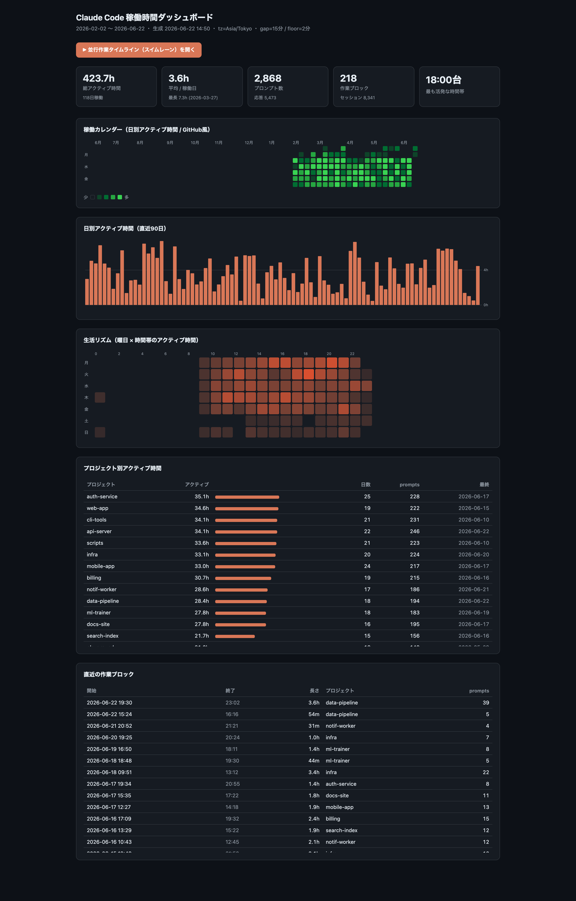
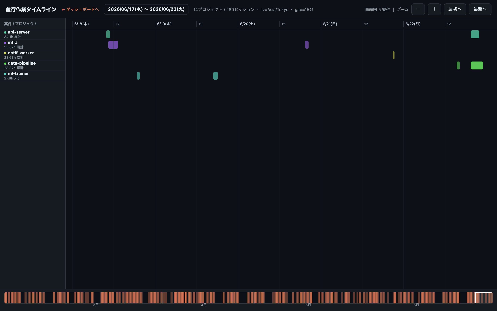

# cc-worklog

**Claude Code / Codex / Antigravity** の稼働時間 / タイムラインを分析するツール（**依存ゼロ・完全ローカル・Bun 単一バイナリ**）。
複数の AI コーディングツールのセッションログを横断し、**アクティブ時間**（実際に手を動かしていた時間）を
ギャップベースで推定して、自己完結の **HTML ダッシュボード** と **並行作業タイムライン** を生成する。

データは外部に一切送信されない（HTML も CDN 不使用の自己完結）。

## 対応ソース

| ソース | ログの場所 | 内容 |
|---|---|---|
| `claude` | `~/.claude/projects/**/*.jsonl` | Claude Code。user/assistant イベント |
| `codex` | `~/.codex/sessions/**/*.jsonl` | Codex CLI。`session_meta.cwd` で案件判定、event_msg/response_item をイベント化 |
| `antigravity` | `~/.gemini/antigravity-cli/history.jsonl` | Antigravity。ユーザープロンプト（`workspace` で案件判定） |

各ソースの `cwd`/`workspace` を git ロールアップで同じ案件名に集約するので、
**同一リポジトリを Claude・Codex・Antigravity のどれで触っても 1 つの案件に合流**する。
全ソースを 1 本の時系列にマージして稼働時間を出すため、ツールをまたいだ同時刻の重複も二重計上しない。
`--source claude` のように絞り込みも可能。

## スクリーンショット

> 以下はデモ用の合成データ（`bun run scripts/gen-demo.ts`）で生成したもの。実データは含まれません。

ダッシュボード:



並行作業タイムライン（スイムレーン）:



## インストール

### ワンライナー（macOS / Linux・推奨）
OS/アーキを自動判定して最新リリースバイナリを取得する:

```sh
curl -fsSL https://raw.githubusercontent.com/Mojashi/cc-worklog/main/install.sh | sh
```

インストール先は `~/.local/bin`（無ければ `/usr/local/bin`）。`CCW_INSTALL_DIR=/path sh` で変更可。

### 手動ダウンロード
[Releases](https://github.com/Mojashi/cc-worklog/releases) から該当アセットを取得して実行権限を付ける:

```sh
# 例: macOS (Apple Silicon)
curl -fsSL -o cc-worklog https://github.com/Mojashi/cc-worklog/releases/latest/download/cc-worklog-darwin-arm64
chmod +x cc-worklog && ./cc-worklog --open
```

配布アセット: `cc-worklog-{darwin,linux}-{x64,arm64}` / `cc-worklog-windows-x64.exe`（+ `SHA256SUMS.txt`）

Windows は Releases から `cc-worklog-windows-x64.exe` を取得してください。

### ソースからビルド（要 [Bun](https://bun.sh)）
```sh
bun install            # 型定義のみ(devDependency)。実行・ビルドには不要
bun run start          # そのまま実行
bun run build          # dist/cc-worklog を単一バイナリにコンパイル
bun run build:all      # 全OS/アーキ向けにクロスコンパイル
```

## 使い方

```sh
cc-worklog                 # 解析して dashboard.html + timeline.html を生成 + サマリ表示
cc-worklog --open          # 生成後にブラウザで開く
cc-worklog --json out.json # 集計結果を JSON でも出力
```

初回は全 jsonl をパースする（数万ファイルでも ~20 秒）。結果は `~/.cache/cc-worklog/` に
ファイル単位でキャッシュされ、2 回目以降は変更があったファイルだけ再パースする。

| フラグ | 既定 | 説明 |
|---|---|---|
| `--gap N` | 15 | 無操作 N 分以上で作業ブロックを区切る |
| `--floor N` | 2 | 各作業ブロック先頭に N 分の下駄を履かせる（単発プロンプト・思考時間の補正） |
| `--out PATH` | dashboard.html | 出力 HTML パス（timeline.html は同じディレクトリに出る） |
| `--json PATH` | - | 集計 JSON も書き出す |
| `--month YYYY-MM` | - | 指定した暦月（ローカルタイムゾーン）だけ集計する |
| `--source a,b` | all | 集計ソース（`claude` / `codex` / `antigravity`。既定は全部） |
| `--open` | - | 生成後にブラウザで開く |
| `--ignore a,b` | - | 除外プロジェクト（カンマ区切り・複数可）。`ctlignore.txt` にも書ける |
| `--rebuild` | - | キャッシュを無視して全ファイル再パース |
| `--no-cache` | - | キャッシュを使わない |

## アクティブ時間の定義

全プロジェクト横断で `user` / `assistant` イベントを時系列にマージし、
連続イベントの間隔が `--gap`（既定15分）以内なら稼働中とみなして合算する。
gap を超えたら「作業ブロック」の区切り。各ブロックの先頭には `--floor`（既定2分）を加算する。

プロジェクト別には、各プロジェクトを単独で gap 判定した「案件内時間」を計算する。
並行作業で案件内時間が重なる場合は、グローバル作業ブロックの総時間を各案件の案件内時間に比例して按分する。
そのため「按分時間」の合計は全体のアクティブ時間と一致し、二重計上は起きない。
ダッシュボードには、合計可能な「按分時間」と、並行案件との重複を含む「案件内時間」を併記する。

## プロジェクトの集約

各セッションの `cwd` から親方向に `.git` を探し、**直近の git リポジトリのディレクトリに巻き取る**。
例: `~/repos/myapp/backend/scripts` での作業は `myapp` に集約される。
git リポジトリが見つからない場合は cwd のディレクトリ名をそのまま使う。

## プロジェクトの除外

集計から外したいプロジェクトは、`ctlignore.txt.example` を `ctlignore.txt`（カレントディレクトリ）に
コピーして 1 行 1 リポジトリ名で書く（`#` でコメント可）。`--ignore name1,name2` でも追加できる。

```sh
cp ctlignore.txt.example ctlignore.txt
```

除外プロジェクトのイベントは**タイムライン上のアンカーとしては残る**が、稼働時間としては
一切計上されない。これにより「除外プロジェクトを挟んで前後にある別プロジェクトのイベント」が
連続扱いされて時間を吸い取ってしまう誤集計を防いでいる（＝除外した時間は誰にも帰属しない）。

## ダッシュボードの内容

- サマリカード（総アクティブ時間 / 平均 / プロンプト数 / 作業ブロック / 最も活発な時間帯）
- 稼働カレンダー（GitHub 風ヒートマップ、日別アクティブ時間）
- 日別アクティブ時間の棒グラフ（直近90日）
- 生活リズム（曜日 × 時間帯のヒートマップ）
- プロジェクト別アクティブ時間
- 直近の作業ブロック一覧

## 並行作業タイムライン（timeline.html）

全期間を 1 枚に並べた横スクロール式の連続タイムライン。ダッシュボード上部のボタンからも開ける。

- **左サイドバーに案件（プロジェクト）名**（色＋累計時間）。**1行＝1案件**
- **表示行は「今見えている時間範囲」に連動**：その範囲にセッションがある案件だけを上から詰めて表示し、
  横スクロールに応じて行が出たり消えたりする（ヘッダに「画面内 N 案件」を表示）
- 軸に**日付（曜日付き）＋時刻ラベルを常時表示**。上部に表示中の日付範囲、マウス位置に日時カーソル線
- 下部**ミニマップ**：全期間の活動密度＋現在位置。クリック/ドラッグで任意の時期へ一気にジャンプ
- スクロールはブラウザ標準（トラックパッド／スクロールバー）、Ctrl/⌘＋ホイール または ＋／－＝ズーム
- バーにホバーで案件名・期間・稼働時間・prompt数

## リリース

`v*` タグを push すると GitHub Actions（`.github/workflows/release.yml`）が全 OS/アーキ向けに
クロスコンパイルし、GitHub Release にバイナリと `SHA256SUMS.txt` を添付する。

```sh
git tag v0.1.0 && git push origin v0.1.0
```

## ライセンス
MIT
